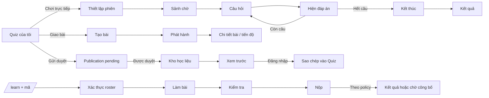

# SmartTeach — Screen Flow Contract

Status: Draft for approval
Baseline: `main@1eab7e0`
Design source: `figmaDesign/foundation.png`, `landingPage.png`,
`teacherScreen.png`, `PRODUCT.md`, `DESIGN.md`

## 1. Mục tiêu của contract

Tài liệu này là annotated screen contract cho các frame chưa có trong Figma.
Nó khóa information architecture, hierarchy, trạng thái, responsive và mapping
UI ↔ dữ liệu trước khi code production. Nó không thay thế Foundation Figma và
không cấp quyền ghi vào Figma/Supabase/GitHub thật.

## 2. Quy tắc thị giác dùng chung

- Product surface theo lane **Restrained**: nền `Subtle Wash`, nội dung trên
  `Paper`, Action Blue chỉ cho action/selection/focus; tối đa một điểm vàng có
  ý nghĩa trên mỗi màn hình.
- Be Vietnam Pro; tiêu đề app không dùng display scale của landing. Body tối
  thiểu 16px trên student/projector flow, label 14px, touch target 44px.
- Card chỉ dùng cho một nhóm dữ liệu/thao tác độc lập; không lồng card. Bảng dữ
  liệu dùng row + header thật, mobile đổi thành summary row/card có nhãn.
- Motion: press 100ms, state 180ms, sheet/dialog 260ms; không page-load
  choreography, magnetic, tilt hay scroll animation trong product surface.
- Translucency chỉ cho topbar/menu/sheet. Host, player, game iframe, whiteboard
  và bảng dữ liệu dùng bề mặt đặc để giữ tương phản.
- Mọi state có chữ/icon, không chỉ màu. Focus ring 2px + offset; keyboard order
  đi theo thứ tự thị giác; reduced-motion gần như tức thời.
- State coverage bắt buộc: loading, empty, error, offline, success, disabled.
  Review responsive ở 375px, 768px và 1280px; đạt WCAG AA và kiểm riêng
  `prefers-reduced-motion`.

## 3. Information architecture

### Teacher shell

```text
Không gian dạy học
├─ Tổng quan                 /dashboard
├─ Lớp học                   /my-classes
├─ Quiz                      /my-quizzes
├─ Bài đã giao               /assignments
├─ Học liệu                  /library
├─ Kho game                  /games
└─ Tiện ích                  /tools
```

- Desktop ≥1024: sidebar expanded; 720–1023: rail có tooltip; <720: native
  dialog drawer và trả focus về nút menu.
- “Học liệu” là public discovery; “Quiz” là tài sản riêng. Không gộp hai mental
  model vào một màn hình.
- Brand và login fallback vào `/dashboard`; CTA tạo lớp/quiz vẫn đi thẳng tới
  đúng task, không ép qua dashboard.

### Student/public surfaces

```text
Live:        /play → lobby → question → reveal → final
Assignment:  /learn → /learn/[code] → question runner → review → submitted
Library:     /library → /library/[id] → login/clone
```

Live và assignment không dùng TeacherShell. Student surfaces dùng header tối
giản gồm logo, tên hoạt động và help/exit khi có hành vi thật.

### Baseline implementation map

| Concern | Current owner | Planned extension |
| --- | --- | --- |
| App chrome/auth | `app-chrome.tsx`, `teacher-shell.tsx`, `src/proxy.ts` | dashboard/assignment/library nav + protected matcher |
| Class roster | `classes-manager.tsx`, `class-editor.tsx`, `lib/classes/api.ts` | roster credential/action entry points |
| Quiz | `components/quiz/**`, `lib/quiz/**` | “Giao bài”, publication metadata/status |
| Live | `components/live/**`, `lib/live/rpc.ts`, `types.ts`, `results.ts` | presentation only trong Phase 03 |
| Game/tool | `game-*`, `*-tool`, `tool-page/stage` | frame/state completion trong Phase 02 |
| Assignment | chưa có | `lib/assignments/**`, `components/assignments/**`, migrations + routes |
| Library | share/clone token riêng lẻ hiện có | `lib/library/**`, `components/library/**`, publication migration + routes |
| Database | migrations class/quiz/live/results/auto/treasure/import | additive assignment và publication migrations; không sửa migration cũ |
| Verification | Vitest unit, 8 DB suites, 219 Playwright cases, load + bundle scan | assignment/library DB/E2E/load/security suites |

## 4. Flow overview



## 5. Screen inventory và layout contract

### 0. Route đã có frame và giữ nguyên contract hiện tại

Các route sau đã được Figma Teacher Screen + plan trước triển khai và kiểm thử;
Phase mới chỉ nối navigation/data, không thiết kế lại hierarchy:

| Route | Coverage giữ nguyên |
| --- | --- |
| `/` | Landing Figma đã duyệt; chỉ đổi link/copy khi chức năng thật sẵn sàng |
| `/login` | Desktop/mobile auth, sign-in/sign-up/Google/error/privacy link |
| `/my-classes` | List, empty, create và favorite section |
| `/my-classes/[id]` | Student roster, rename/add/edit/delete + mobile sheet |
| `/my-quizzes` | List, empty, create/import/history/actions |
| `/my-quizzes/[id]` | Editor bốn loại câu, reorder/share/host, responsive panels |
| `/my-quizzes/import` | Upload/text/preview/error/create |
| `/tools` | Catalogue desktop/mobile + search/filter empty state |
| `/tools/countdown` | Ready/running/last-ten/finished/fullscreen |

Auth callback là route handler, không phải screen. Loading/error/not-found của
các segment trên tiếp tục dùng Foundation và acceptance hiện có.

### A. Các bề mặt đang chạy nhưng thiếu frame

| ID | Route | Primary action | Desktop | Mobile | Key states |
| --- | --- | --- | --- | --- | --- |
| A1 | `/games` | Mở một game | Header + search/filter row + featured row + result list | Search sticky, filter sheet, single-column list | loading, empty filter, favorite, signed-out favorite, error |
| A2 | `/games/[id]` | Chơi toàn màn hình | Breadcrumb + title/actions + 16:9 stage + credits | title/action stack + stage edge-to-edge | iframe loading/error, fullscreen unsupported |
| A3 | `/tools/draw` | Bốc một tên | Control panel trái, projector result phải | Setup trên, result lớn dưới | empty, ready, drawing, result, exhausted, reset |
| A4 | `/tools/groups` | Chia nhóm | Roster/config trái, group board phải | Setup rồi result; edit quay lại bằng action rõ | invalid number, result, long names, reshuffle |
| A5 | `/tools/whiteboard` | Viết/vẽ | Compact toolbar trên stage, canvas chiếm phần còn lại | Bottom/compact toolbar, canvas giữ vùng vẽ lớn | ready, drawing, eraser, clear confirmation, fullscreen |
| A6 | `/shared/quiz/[token]` | Sao chép quiz | Preview column + sticky summary/action | Preview single column + sticky bottom CTA | loading, revoked/invalid, signed-out, clone busy, limit/error |
| A7 | `/privacy` | Hiểu/xử lý dữ liệu | TOC hẹp + article readable 65–75ch | Article, TOC bằng details | reviewed/draft banner, long content |
| A8 | 404 | Quay về đúng khu vực | Centered compact state, suggested routes | Same, CTA full-width | authenticated/public copy |

### B. Quiz trực tiếp

| ID | Route/state | Hierarchy và controls | State/API source |
| --- | --- | --- | --- |
| B1 | `/host` history | Page title, “Chọn quiz để bắt đầu”, recent sessions table/list | `host.history`, quiz list |
| B2 | Start session | Quiz summary, three option groups, one primary “Tạo phòng” | `host.create`, quiz problems, active-session conflict |
| B3 | `/host/[id]` lobby | PIN + QR là hero; participant chips/list; lock, remove, start | `HostState.status=lobby` |
| B4 | Host question | Question + timer là hero; option board/distribution; bottom control dock | `status=question`, close/open state |
| B5 | Host reveal | Correct key + distribution; leaderboard; next/pause/auto countdown | `status=reveal` |
| B6 | Host ended | Podium + “Xem kết quả chi tiết” | `status=ended` |
| B7 | `/host/[id]/results` | Summary strip, ranking, question table, answer matrix tabs | `host.results` |
| B8 | `/play` join | PIN 6 số, biệt danh, “Tham gia”; errors ngay dưới field | `player.join` codes |
| B9 | Player lobby | Tên + số người + connection status; exit action | `phase=lobby` |
| B10 | Player question | Progress/timer, prompt, answer tiles/input, explicit submit | `phase=question` |
| B11 | Player reveal | Correct/your answer + points/rank; treasure action nếu có | `phase=reveal` |
| B12 | Player final | Rank/score/treasure summary + leave | `phase=ended` |

Host desktop/projector dùng tối đa 1280px content nhưng stage có thể full-width.
Player mobile là baseline; desktop chỉ tăng measure, không kéo answer tiles quá
rộng. Connection `live/polling/offline` luôn có text, không chỉ dot màu.

### C. Dashboard giáo viên

#### C1 — Có dữ liệu

```text
[Xin chào + ngày]                              [Tạo quiz] [Tạo lớp]
[Việc cần tiếp tục: assignment mở / session đang chạy nếu có]
[Lớp gần đây]                 [Quiz gần đây]
[Bài đã giao]                 [Phiên gần đây]
[Kho game / Tiện ích dùng nhanh — text links, không metric card]
```

- Mỗi khối tối đa 3–5 items + “Xem tất cả”.
- Metric chỉ xuất hiện khi có hành động: “12/30 đã nộp” mở assignment detail;
  “32 học sinh” mở class detail.
- Phase 04 ban đầu chưa có assignment thì khối này không render. Phase 07 thêm
  khối bằng data thật, không placeholder “sắp ra mắt”.

#### C2 — Tài khoản mới

Một empty state duy nhất: “Bắt đầu bằng một lớp hoặc một quiz”, hai CTA ngang
desktop/dọc mobile; dưới là link game/tool dùng ngay. Không hiển thị 0-metrics.

#### C3 — Partial error

Khối lỗi giữ chiều cao nội dung hợp lý, có “Thử lại”; các nguồn khác vẫn hiển
thị. Không dùng full-page error khi chỉ một query thất bại.

### D. Assignment — giáo viên

#### D1 — Danh sách `/assignments`

- Header: “Bài đã giao”, CTA “Giao bài mới”.
- Segmented filter: Đang mở / Bản nháp / Đã đóng / Tất cả; search chỉ thêm khi
  dữ liệu thực tế cần, không có trong MVP đầu.
- Desktop row: title, class, trạng thái, due, submitted/roster, overflow menu.
- Mobile summary card: title + status + `12/30 đã nộp` + due; tap toàn row mở
  detail, menu có nút riêng và accessible name.

#### D2 — Tạo bài `/assignments/new`

Một full-page form, không wizard:

1. Chọn quiz (required, link tạo/import nếu empty).
2. Chọn lớp (required, link tạo lớp nếu empty).
3. Thời gian mở/hạn; timezone Việt Nam hiển thị rõ.
4. Công bố kết quả: ngay sau nộp hoặc sau khi bài đóng.
5. Review summary; primary “Phát hành”, secondary “Lưu bản nháp”.

Desktop: form 2/3 + sticky summary 1/3. Mobile: một cột, bottom action bar không
che keyboard. Invalid quiz hiển thị problem list và link editor, không disabled
CTA không giải thích.

#### D3 — Chi tiết `/assignments/[id]`

Header có title/class/status, public code + copy/QR, primary action theo state:

- Draft: “Phát hành”.
- Published/open: “Đóng bài”.
- Closed: không CTA primary; “Xem kết quả” là selected tab.

Tabs: **Tổng quan**, **Học sinh**, **Câu hỏi**. Tab dùng URL query để back/forward
và deep link. Tổng quan chứa schedule, link, policy. Học sinh là progress table.
Câu hỏi là correct/unanswered rate và drill-down.

#### D4 — Access cards sheet

- Mở từ “Mã học sinh”. Sheet gần đặc, không modal toàn màn desktop.
- List student + masked credential state + actions Generate/Rotate/Revoke/Print.
- Raw credential chỉ hiện ngay sau generate/rotate với copy/print warning.
- QR không bao gồm tên học sinh trong URL; accessible text card có tên do teacher
  print, không gửi qua public route.

### E. Assignment — học sinh

#### E1 — Entry `/learn`

Hai field visible-label: mã bài và mã cá nhân; hỗ trợ paste/scan QR. Primary
“Vào làm bài”. Không gọi mã cá nhân là mật khẩu/tài khoản.

#### E2 — Runner `/learn/[code]`

```text
[SmartTeach] [Tên bài] [Đã lưu / Mất kết nối]
[Câu 3/10] [progress bar]
[Prompt]
[Answer controls]
[Quay lại]                         [Lưu và tiếp tục]
```

- Chỉ một câu mỗi màn; answer UI reuse bốn loại quiz nhưng không dùng màu game
  rực cho form homework nếu không cần.
- Save theo bước, trạng thái “Đang lưu / Đã lưu / Chưa lưu được”. Local draft
  giữ tới retry; refresh tải state server và merge theo version/timestamp rõ.
- Review screen liệt kê answered/unanswered; click item quay đúng câu.
- Submit confirmation nói rõ không sửa được sau nộp.

#### E3 — Submitted

- Release ngay: score, đúng/tổng, question review theo policy.
- Release sau close: “Đã nộp lúc …; kết quả sẽ hiện sau khi thầy cô đóng bài”,
  không trả answer key trong DOM/network.
- Closed/expired trước submit: giữ receipt của answer đã save và hướng dẫn liên
  hệ giáo viên; không cho tiếp tục mutation.

### F. Kho học liệu được duyệt

#### F1 — Browse `/library`

- Header + search, subject chips/select, grade filter, result count.
- Desktop: toolbar một hàng khi đủ chỗ; result dùng mixed-density list/grid,
  không lặp icon-card giống hệt. Mobile: search trước, filter button mở sheet.
- Item: title, subject/grades, question count, mô tả ngắn; không rating, clone
  count hoặc author email giả.

#### F2 — Detail `/library/[id]`

- Main: title, metadata, description, sample/all question preview không key.
- Side/sticky summary: question count, “Sao chép vào Quiz của tôi”; signed-out
  CTA đưa login với safe `next`.
- Pending/rejected/hidden trả unavailable/not-found generic ở public route.

#### F3 — Submit publication

Trong quiz editor/list action “Gửi vào kho học liệu” mở full-page/sheet theo
không gian:

- Required: subject, ít nhất một grade, description 40–300 chars.
- Review snapshot warning: thay đổi quiz sau gửi không đổi bản đang duyệt.
- Status vocabulary: Bản riêng tư / Chờ duyệt / Đã công khai / Cần chỉnh sửa /
  Đã ẩn. Reason của reviewer hiển thị bằng callout có next action.
- Teacher có Withdraw/Resubmit; không có nút Approve/Hide trong client.

## 6. Responsive contract

| Context | Navigation | Main layout | Data density | Overlay |
| --- | --- | --- | --- | --- |
| 320–719 | Drawer/minimal header | one column; sticky bottom CTA khi cần | summary rows/cards; labels visible | bottom sheet hoặc full-height dialog |
| 720–1023 | 88px rail | one/two columns; master-detail chỉ khi đủ | compact table/list | anchored sheet/dialog |
| ≥1024 | expanded sidebar | max-width 1200–1280; two columns khi có summary | full table + filters | sheet/dialog không che context |
| Projector/live | no teacher shell | stage-first, large type/controls | chỉ state cần cho giờ học | không blur/glass trên stage |

Ở mọi width: không separate mobile codebase, không hide core action, không dựa
hover. Safe-area cho sticky action trên mobile; text dài wrap, không ellipsis ở
thông tin quyết định như title/error/student name.

## 7. State ↔ API/RPC contract

| UI state/action | Contract source | Error/recovery |
| --- | --- | --- |
| Dashboard classes/quizzes/sessions | existing list APIs + `host.history` | partial retry từng block |
| Live phase | `HostState` / `PlayerState` | realtime → polling; offline banner |
| Assignment draft/publish/close | teacher assignment RPC | field/problem mapping; no partial snapshot |
| Student entry | assignment code + roster credential exchange | generic invalid/revoked/closed; retry/manual entry |
| Runner save | idempotent answer upsert | keep local draft + retry |
| Runner submit | row-locked idempotent submit | same receipt on retry |
| Progress/analytics | owner-only assignment result RPC | empty before attempts; partial table error |
| Publication submit/status | owner publication RPC | pending/rejected reason/withdraw |
| Library browse/preview | approved-only public RPC | bounded empty/error, unavailable generic |
| Clone | authenticated atomic clone RPC | login/quiz limit/error; no partial quiz |

## 8. Content và realistic ranges

- Lớp: 0–20; học sinh/lớp: 0–100; tên dài tới 100 ký tự.
- Quiz: 0–50; câu/quiz: 1–50; option/câu: 2–6; bốn question kinds.
- Live: 0–50 active participants; history phân trang, session có thể mất quiz gốc.
- Assignment: 0/new account, typical 3–10 active, long history phải bounded;
  roster 100, one active attempt/student/assignment.
- Library: kết quả luôn pagination; title 100, description 40–300; subject/grade
  dùng vocabulary hiện có trong `src/lib/catalog.ts`.
- Mọi empty/error copy gọi “Thầy cô” ở teacher surface; student copy ngắn, trực
  tiếp và không nhắc chi tiết database/token.

## 9. Accessibility và interaction acceptance

- Tab đúng semantics + arrow keys/roving tabindex; URL state không phá focus.
- Dialog/sheet dùng native dialog hoặc pattern đã có: Escape, backdrop, initial
  focus, restore focus; background inert.
- Data table có header; mobile card giữ accessible name/value; progress có text
  `12 trên 30`, không chỉ bar.
- QR luôn có manual code fallback. Copy action có live-region feedback.
- Timer/connection/save state dùng `aria-live` có tiết chế, không announce mỗi
  tick giây.
- Error dưới field với `aria-describedby`; placeholder không thay label.
- Destructive close/delete/reset/revoke có confirm vì khó hoặc không thể undo.

## 10. Điều cần duyệt trước production code

1. Teacher navigation chia thành bảy mục như mục 3, với “Quiz” và “Học liệu” là
   hai mental model riêng.
2. Tạo assignment dùng một full-page form + sticky summary, không wizard/modal.
3. Assignment detail dùng ba tab URL-backed: Tổng quan / Học sinh / Câu hỏi.
4. Student không tài khoản dùng mã bài + credential roster; QR là đường nhanh,
   manual code là fallback.
5. Library là curated: teacher submit/withdraw/resubmit; client không có màn
   moderator, chỉ hiển thị status/reason.
6. Visual/responsive/state contract trong tài liệu này được dùng để tạo frame
   Figma sau khi có quyền ghi, hoặc làm contract trực tiếp cho implementation.
